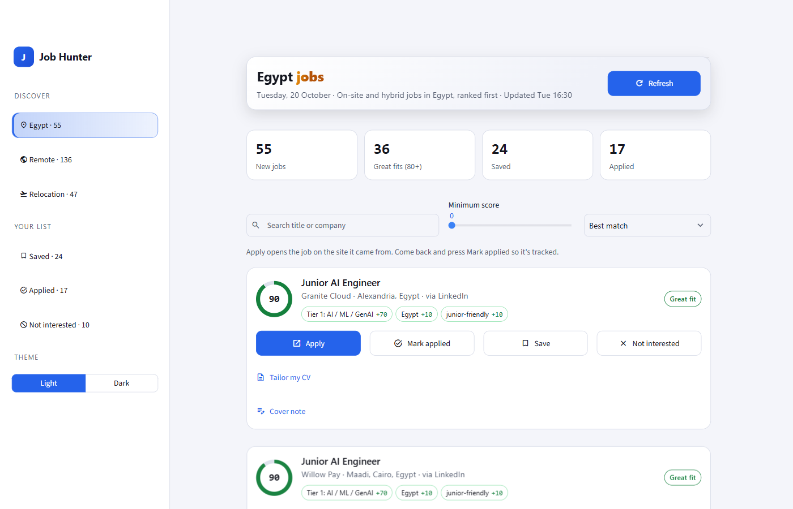

# Job Hunter

A job-finding agent that stays on your side: it finds and ranks jobs for you, and never applies, scrapes LinkedIn, or invents skills on your behalf.



## Why it is different

- **No LinkedIn scraping.** It never logs in to LinkedIn or opens its job pages. It reads the job-alert emails LinkedIn already sends you, with read-only Gmail access.
- **Every score has a reason.** Rule-based, not a black box: `Tier 1: AI / ML / GenAI +70`, `Egypt +10`, `senior role -10`. You can read it and change it.
- **It learns from you.** Hide, save and apply, and the ranking adjusts.
- **Honest CV advice.** *Tailor my CV* uses a local model to match a job to your real skills and projects. Code checks the one-line summary so it can never name a tool that is not in your CV. It gives advice only and never edits your CV.
- **Free and local.** No paid APIs. Scoring is rules; the optional writer runs on a local [Ollama](https://ollama.com) model.
- **You stay in control.** Apply opens the job page. Nothing is ever sent for you.
- **Tested.** 85 automated tests.

Jobs come from your LinkedIn alert emails and free public feeds: Remotive, Remote OK, We Work Remotely, Jobicy, Himalayas, Working Nomads. Every card links back to its source.

## What you get

| Tab | Jobs |
|---|---|
| Home country (Egypt by default) | On-site and hybrid jobs in your home country, ranked first |
| Remote | Remote jobs you can do from anywhere |
| Relocation | Jobs abroad (Canada, UAE, Saudi Arabia, Europe) |
| Saved / Applied / Not interested | Your own lists, with Restore and Undo |

Each job shows a score and why (for example `Tier 1: AI / ML / GenAI +70`, `Egypt +10`, `senior role -10`). The agent also learns from what you hide, save and apply to, and can draft a short cover note (only when you press the button, and only kept if you press Save note). A copy box under the note lets you paste it into the application in one click.

## Setup (Windows)

```powershell
python -m venv .venv
.venv\Scripts\python -m pip install -r requirements.txt
copy profile.example.yaml profile.yaml     # then put your name and gmail in profile.yaml (it stays private)
```

1. **LinkedIn alerts.** Create daily job alerts on LinkedIn for your roles and places, sent to your Gmail.
2. **Gmail access (read-only).** In Google Cloud: create a project, enable the Gmail API, create an OAuth *Desktop app* client, and save it as `credentials.json` in this folder. Add your Gmail as a test user.
3. **First login.** Run `login_gmail.bat` once and allow read-only access. (While the Google app is in "Testing" the login expires about weekly; run it again when the dashboard says so.)
4. **Run it.**
   ```powershell
   .venv\Scripts\python run_daily.py        # collect + score
   open_dashboard.bat                       # open the dashboard
   ```
5. **Automatic daily run (optional).** `install_windows_task.ps1` creates a 7:00 AM task and a Desktop shortcut. The dashboard also refreshes itself on open if its list is older than `auto_refresh_hours`.

`credentials.json`, `token.json`, `jobs.db`, `profile.yaml`, `settings.json`, `samples/` and `logs/` are git-ignored on purpose. Never commit them.

## Tests

```powershell
.venv\Scripts\python -m pytest -q
```

## Layout

| File | Job |
|---|---|
| `collect/` | Gmail reader, LinkedIn email parser, remote-job feeds |
| `pipeline.py` | One refresh: LinkedIn + feeds, scored and saved once |
| `score.py`, `learn.py`, `classify.py` | Ranking rules, learning from clicks, Egypt/Remote/Relocation tabs |
| `cover.py` | Optional cover-note draft with a local model |
| `app.py`, `ui.py`, `stats.py` | The Streamlit dashboard, its themes and numbers |
| `db.py`, `settings.py` | SQLite store and small settings |
| `scheduled_run.py`, `install_windows_task.ps1` | The daily 7:00 AM run |

## Notes

- Home country: Egypt by default. For another country, set `locations.priority` (its name) and `locations.home_cities` (lowercase words that appear in its job locations, like `[germany, berlin]`) in `profile.yaml`.
- Remote feed terms: each source asks to be credited with a link back, which the cards do. Remotive asks for at most about 4 requests a day; cooldowns are in `profile.yaml`.
